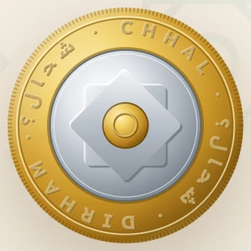
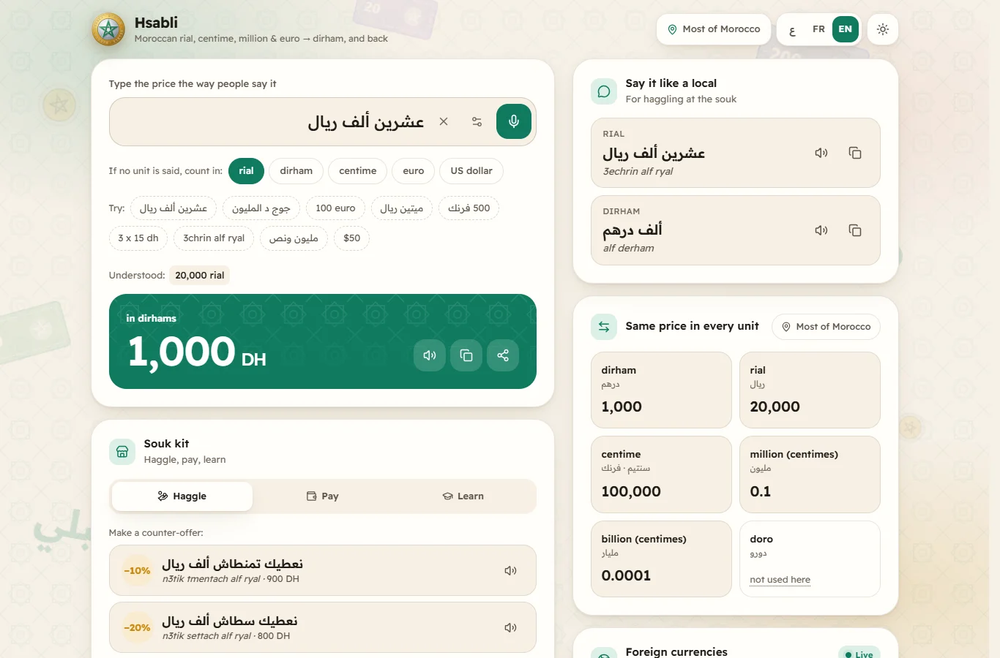
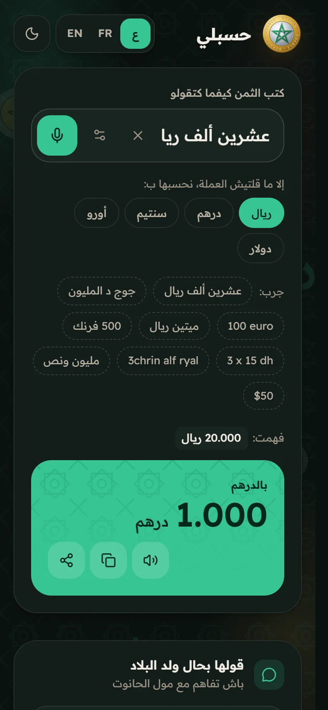
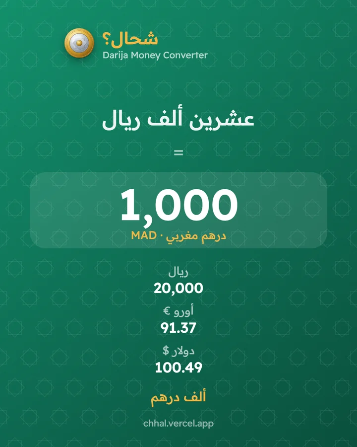
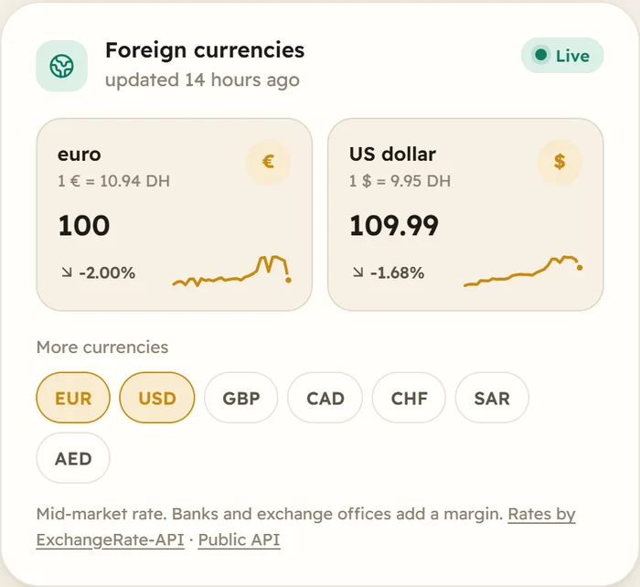
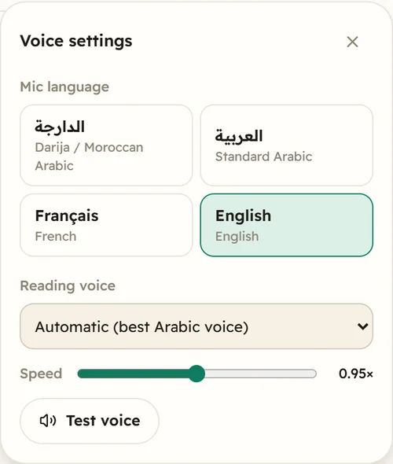

# حسبلي Hsabli — Darija Money Converter

> **New name (2026-10-17):** this app was called *Chhal?* until v0.9. It is now **Hsabli · حسبلي** ("count it for me") because chhal.ma is an unrelated Moroccan calculator site. The URL and repository stay the same.

> Type or say a price the way Moroccans say it — **"عشرين ألف ريال"**, **"جوج د المليون"**, **"3chrin alf ryal"**, **"100 euro"** — and get Dirham instantly. Works the other way round, keeps working offline, and comes with a souk kit for haggling, paying and learning.

[](https://github.com/Bosaj/darija-money-converter/actions/workflows/ci.yml)


**Live:** https://darija-money-converter.vercel.app · **Status:** v0.6 — live rates API with trends, Moroccan-star coin, Darija voice in/out, place detection.
**Author:** Oussama EL HADJI. Part of the Bosaj ideas portfolio (sibling repo: `dual_portfolio_hub`).

<p align="center"></p>
<p align="center">
  
</p>
<p align="center">
  
  &nbsp;
  
</p>
<p align="center">
  
  &nbsp;
  
</p>

---

## Problem

In Morocco people quote prices in **rial**, **santim/franc** or **millions** — and some regions add **doro** — yet it is all Dirham. Visitors, and even locals from another region, get lost: is "عشرين ألف" twenty thousand rial (1,000 DH) or dirhams? This is a dialect-and-numbering problem, not a currency exchange, so ordinary converters don't help.

## What it does

| | |
|---|---|
| **Understands Darija** | Arabic script, Latin "Arabizi" (`3chrin`, `jouj`, `khamsmya`), French, digits (`50 000`, `1.250`, `٥٠`), mixed units (`عشرين درهم و خمسين سنتيم`), halves and quarters (`مليون ونص`, `مليون وربع`). |
| **Moroccan conventions built in** | A bare `مليون` means a million *santim* (10,000 DH); `عشرين درهم و خمسين` means 20.50 DH; with no unit it uses your chosen default (rial by default). |
| **Every unit at once** | Dirham, rial, santim, million, milliard, doro — tap to copy. |
| **Franc** | `500 فرنك` = 5 DH: the franc is the old name of the santim (1 DH = 100 francs since 1960). A switch in the region dialog makes it a whole dirham instead, for people who use it that way (flagged as unconfirmed). |
| **Say it like a local** | Reverse conversion spelled the way a seller says it, in Arabic and Arabizi, with text-to-speech: 50 DH → "ألف ريال" / "alf ryal". |
| **Regional presets** | General, Oriental (Oujda, Berkane…), Rif (Nador, Al Hoceima: douro = 0.5 DH, `جوج د الميا` = 100 DH), North (Tangier, Tetouan…) and a custom preset. Unverified values are flagged, with a one-click "correct this value" issue form. |
| **Voice input** | Dictate the price (Web Speech API, `ar-MA`), parsed by the same Darija engine. |
| **Share cards** | One tap renders a 1080×1350 price card and opens the native share sheet (or downloads the PNG). |
| **Euro, dollar & more** | `100 euro`, `50€`, `$20`, `ألف أورو`, plus GBP, CAD, CHF, SAR, AED. Two-word names such as `ريال سعودي` or `فرنك سويسري` don't clash with the Moroccan rial or franc. Live mid-market rates, cached for offline use, with a dated fallback. |
| **Calculator** | `3 x 15 dh`, `500 ريال × 4`: the quantity shows in the "understood" line. |
| **Souk kit** | *Haggle*: −10/−20/−30% counter-offers spoken in Darija ("نعطيك …") plus useful phrases. *Pay*: the fewest notes and coins to hand over. *Learn*: a cheat sheet and a price quiz with a streak counter. |
| **Coin logo** | A bimetallic coin in the spirit of the 10 DH piece: brass ring, nickel centre, reeded edge, struck inscription and a raised, green-enamelled **interlaced Moroccan star**. It flips when tapped. There is deliberately no royal portrait: the King's image is legally protected and a portrait side would imitate real currency. |
| **Live rates & trends** | Each currency shows its rate, the ▲/▼ change against yesterday and a 30-day sparkline. Rates refresh every 15 minutes while the app is open, are cached for offline use, and are served by the app's own API. |
| **Voice in Darija** | The mic speaks Darija (ar-MA), Standard Arabic, French or English, with live text and a level meter. The parser also reads what speech engines output: `عشرون ألف`, `ثلاثمائة`, `quatre-vingt-dix`, `fifteen thousand`. Text-to-speech prefers a Moroccan voice (e.g. Edge's ar-MA neural voices) and has a voice and speed picker plus "read the result". |
| **Detect my place** | One tap sets the region preset (general / Oriental / North) from your nearest Moroccan city. Abroad, it switches bare numbers to your home currency. Matching runs on the device and coordinates are never sent. Without permission, the time zone picks your first foreign currency. |
| **PWA** | Installable, fully offline, no backend, no tracking. Links are shareable: `?q=جوج د المليون`. |
| **Three languages** | Darija/Arabic (RTL), French, English · light/dark/system theme · reduced-motion aware. |

## Public API

Both endpoints are free, CORS-open and CDN-cached.

### `GET /api/rates`

```
https://darija-money-converter.vercel.app/api/rates?symbols=EUR,USD&days=30
```

```json
{
  "base": "MAD",
  "updated": 1791590551000,
  "source": "exchangerate-api.com",
  "rates": { "EUR": { "mad": 10.9449, "change": -0.21 }, "USD": { "mad": 9.9509, "change": 0.12 } },
  "history": { "dates": ["2026-09-11", "…", "2026-10-10"], "series": { "EUR": [11.12, "…", 10.93] } }
}
```

- `mad` is the number of dirhams for one unit. `change` is the % change against the previous day.
- Latest rates come from [ExchangeRate-API](https://www.exchangerate-api.com). History comes from [fawazahmed0/currency-api](https://github.com/fawazahmed0/exchange-api) (jsDelivr with a Cloudflare Pages mirror).
- Supported: EUR, USD, GBP, CAD, CHF, SAR, AED. `days` accepts 2–60.

### `GET /api/convert`

```
https://darija-money-converter.vercel.app/api/convert?q=جوج د المليون&unit=rial&region=general
```

Optional `franc=dirham` makes "franc" a whole dirham (default `santim`, 1/100 DH).

The response contains `segments` (what was understood), `dirham`, `values` (every unit, foreign ones included) and `sayIt` (how a local says the amount, in Arabic and Arabizi). `422` means no amount was found.

## Exchange rates

These are mid-market rates. They are cached on the device, and a dated snapshot ships with the app for the first offline visit. Banks and exchange offices add a margin, so the app labels foreign conversions as approximate.

## The conversion table

All ratios live in [`src/data/conventions.json`](src/data/conventions.json) — never in code — so a regional correction is a one-line edit.

| Unit | Dirham value | Status |
|---|---|---|
| ريال rial | 0.05 (1 DH = 20 rial) | verified ([Wikipedia](https://en.wikipedia.org/wiki/Moroccan_dirham)) |
| سنتيم santim | 0.01 (1 DH = 100 santim) | verified |
| فرنك franc | 0.01, the santim's old name (1960–1974: 1 DH = 100 francs) | verified ([Wikipedia](https://en.wikipedia.org/wiki/Moroccan_dirham)) |
| فرنك franc — "franc = dirham" switch | 1 | **unverified**, reported for French usage ([Remitly](https://www.remitly.com/blog/currencies/moroccan-dirham-facts-exchange-guide/), [Journey Beyond Travel](https://www.journeybeyondtravel.com/blog/currency.html)) |
| مليون million (of santim) | 10,000 | verified |
| مليار milliard (of santim) | 10,000,000 | verified |
| دورو doro — Oriental preset (Oujda, Berkane) | 0.05, same as a rial (1 DH = 20 douros) | **unverified**, community-reported |
| دورو doro — Rif preset (Nador, Al Hoceima) | 0.5 = 10 rial (1 DH = 2 douros) | **unverified**, community-reported |
| الميا mya (مية دورو) — Rif preset | 50 (= 100 douros = 1,000 rial) | **unverified**, community-reported |
| دورو doro — North preset (Tangier, Tetouan) | 0.5 | **unverified**, community-reported |

Know the value in your city? [Open a regional-value report](https://github.com/Bosaj/darija-money-converter/issues/new?template=regional-value.yml).

## Architecture

```
src/
  data/conventions.json   units, aliases, regional presets (the only place ratios live)
  lib/normalize.ts        Arabic/Latin normalisation (أ/إ/آ, ة/ه, harakat, Eastern digits)
  lib/lexicon.ts          Darija number words + clitic peeling (و ب ال د ل)
  lib/parse.ts            free text → [{amount, unit, implied}] segments
  lib/spell.ts            number → Darija words (Arabic + Arabizi), noun agreement
  lib/convert.ts          segments ⇄ Dirham, "say it like a local" phrases
  lib/shareCard.ts        canvas price card + Web Share API
  lib/rates.ts            client for /api/rates, device cache, dated snapshot
  lib/place.ts            offline nearest-city + country detection
  hooks/voice.ts          speech-to-text (Web Speech API) and text-to-speech helpers
api/
  rates.ts                live rates + daily change + 30-day history (Vercel Function)
  convert.ts              Darija parser as a JSON API (Vercel Function)
  lib/souk.ts             haggle offers, cash breakdown, cheat sheet, quiz
  components/, App.tsx    React UI (Tailwind v4, RTL-first)
```

- **No backend.** Everything runs client-side; the service worker precaches the app and fonts (Readex Pro, self-hosted).
- **Correctness first.** 120 tests, including round trips: every number the speller writes, every haggle offer and every quiz question must parse back to the same amount.

## Getting started

```bash
npm install
npm run dev        # http://localhost:5173
npm test           # vitest
npm run build      # type-check + production build + service worker
```

Requires Node 20+ (CI uses Node 24).

## Roadmap

- [x] v0.1 — core converter (rial, franc/santim, Dirham) — [#1](https://github.com/Bosaj/darija-money-converter/issues/1)
- [x] v0.2 — regional presets + reverse conversion — [#2](https://github.com/Bosaj/darija-money-converter/issues/2)
- [x] v0.3 — Darija voice / spoken-number input — [#3](https://github.com/Bosaj/darija-money-converter/issues/3)
- [x] v0.4 — polished PWA, shareable price cards — [#4](https://github.com/Bosaj/darija-money-converter/issues/4)
- [x] v0.5 — euro/dollar & foreign currencies, coin logo, souk kit, calculator — [#6](https://github.com/Bosaj/darija-money-converter/issues/6)–[#11](https://github.com/Bosaj/darija-money-converter/issues/11)
- [x] v0.6 — live rates API with trends, Moroccan-star coin, Darija voice in/out, place detection — [#13](https://github.com/Bosaj/darija-money-converter/issues/13)–[#16](https://github.com/Bosaj/darija-money-converter/issues/16)
- [x] v0.7 — franc as its own unit with a franc = dirham switch, wrapped example chips, a Moroccan-money page background — [#18](https://github.com/Bosaj/darija-money-converter/issues/18)–[#20](https://github.com/Bosaj/darija-money-converter/issues/20)
- [x] v0.8 — Rif region (Nador, Al Hoceima) with its douro and الميا, Oujda douro, Nador moved out of Oriental — [#22](https://github.com/Bosaj/darija-money-converter/issues/22)
- [ ] Next — confirm doro (and any other local terms) city by city; a server speech model for Firefox, which has no Web Speech API.

---

## For LLM agents & contributors continuing this project

- **Data, not code:** change ratios only in `src/data/conventions.json`. Anything not confirmed by locals keeps `"verified": false` so the UI flags it.
- **Parser changes need tests:** add cases to `src/lib/darija.test.ts`; keep the spell → parse round-trip green.
- **Client-side only:** do not add a backend or analytics.

**Ground rules:** keep this README in sync with reality; write tests for anything correctness-critical; never commit secrets; follow Conventional Commits (see `CONTRIBUTING.md`).

## License

[MIT](LICENSE) — © 2026 Oussama EL HADJI
