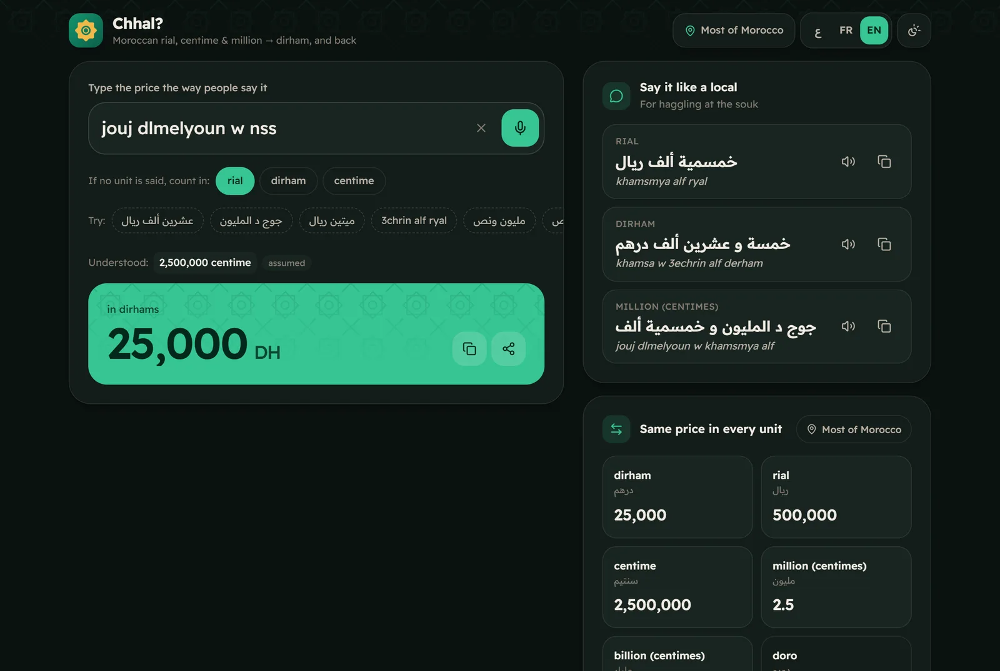

# شحال؟ Chhal? — Darija Money Converter

> Type or say a price the way Moroccans say it — **"عشرين ألف ريال"**, **"جوج د المليون"**, **"3chrin alf ryal"** — and get Dirham instantly. Works the other way round too, and keeps working offline.

[](https://github.com/Bosaj/darija-money-converter/actions/workflows/ci.yml)


**Live:** https://darija-money-converter.vercel.app · **Status:** v0.4 — all four roadmap milestones shipped.
**Author:** Oussama EL HADJI. Part of the Bosaj ideas portfolio (sibling repo: `dual_portfolio_hub`).

<p align="center">
  
</p>
<p align="center">
  
  &nbsp;
  
</p>

---

## Problem

In Morocco people quote prices in **rial**, **santim/franc** or **millions** — and some regions add **doro** — yet it is all Dirham. Visitors, and even locals from another region, get lost: is "عشرين ألف" twenty thousand rial (1,000 DH) or dirhams? This is a dialect-and-numbering problem, not a currency exchange, so ordinary converters don't help.

## What it does

| | |
|---|---|
| **Understands Darija** | Arabic script, Latin "Arabizi" (`3chrin`, `jouj`, `khamsmya`), French, digits (`50 000`, `1.250`, `٥٠`), mixed units (`عشرين درهم و خمسين سنتيم`), halves and quarters (`مليون ونص`, `مليون وربع`). |
| **Moroccan conventions built in** | A bare `مليون` means a million *santim* (10,000 DH); `عشرين درهم و خمسين` means 20.50 DH; with no unit it uses your chosen default (rial by default). |
| **Every unit at once** | Dirham, rial, santim, million, milliard, doro — tap to copy. |
| **Say it like a local** | Reverse conversion spelled the way a seller says it, in Arabic and Arabizi, with text-to-speech: 50 DH → "ألف ريال" / "alf ryal". |
| **Regional presets** | General, Oriental (Oujda…), North (Tangier, Tetouan…) and a custom preset. Unverified values are flagged, with a one-click "correct this value" issue form. |
| **Voice input** | Dictate the price (Web Speech API, `ar-MA`), parsed by the same Darija engine. |
| **Share cards** | One tap renders a 1080×1350 price card and opens the native share sheet (or downloads the PNG). |
| **PWA** | Installable, fully offline, no backend, no tracking. Links are shareable: `?q=جوج د المليون`. |
| **Three languages** | Darija/Arabic (RTL), French, English · light/dark/system theme · reduced-motion aware. |

## The conversion table

All ratios live in [`src/data/conventions.json`](src/data/conventions.json) — never in code — so a regional correction is a one-line edit.

| Unit | Dirham value | Status |
|---|---|---|
| ريال rial | 0.05 (1 DH = 20 rial) | verified ([Wikipedia](https://en.wikipedia.org/wiki/Moroccan_dirham)) |
| سنتيم / فرنك santim, franc | 0.01 (1 DH = 100 santim) | verified |
| مليون million (of santim) | 10,000 | verified |
| مليار milliard (of santim) | 10,000,000 | verified |
| دورو doro — Oriental preset | 0.05 | **unverified**, community-reported |
| دورو doro — North preset | 0.5 | **unverified**, community-reported |

Know the value in your city? [Open a regional-value report](https://github.com/Bosaj/darija-money-converter/issues/new?template=regional-value.yml).

## Architecture

```
src/
  data/conventions.json   units, aliases, regional presets (the only place ratios live)
  lib/normalize.ts        Arabic/Latin normalisation (أ/إ/آ, ة/ه, harakat, Eastern digits)
  lib/lexicon.ts          Darija number words + clitic peeling (و ب ال د ل)
  lib/parse.ts            free text → [{amount, unit, implied}] segments
  lib/spell.ts            number → Darija words (Arabic + Arabizi), noun agreement
  lib/convert.ts          segments ⇄ Dirham, "say it like a local" phrases
  lib/shareCard.ts        canvas price card + Web Share API
  components/, App.tsx    React UI (Tailwind v4, RTL-first)
```

- **No backend.** Everything runs client-side; the service worker precaches the app and fonts (Readex Pro, self-hosted).
- **Correctness first.** 64 tests, including a round-trip check that every number the speller writes is read back exactly by the parser, in both scripts.

## Getting started

```bash
npm install
npm run dev        # http://localhost:5173
npm test           # vitest
npm run build      # type-check + production build + service worker
```

Requires Node 20+ (CI uses Node 24).

## Roadmap

- [x] v0.1 — core converter (rial, franc/santim, Dirham) — [#1](https://github.com/Bosaj/darija-money-converter/issues/1)
- [x] v0.2 — regional presets + reverse conversion — [#2](https://github.com/Bosaj/darija-money-converter/issues/2)
- [x] v0.3 — Darija voice / spoken-number input — [#3](https://github.com/Bosaj/darija-money-converter/issues/3)
- [x] v0.4 — polished PWA, shareable price cards — [#4](https://github.com/Bosaj/darija-money-converter/issues/4)
- [ ] Next — confirm doro (and any other local terms) city by city; offline speech model for browsers without Web Speech.

---

## For LLM agents & contributors continuing this project

- **Data, not code:** change ratios only in `src/data/conventions.json`. Anything not confirmed by locals keeps `"verified": false` so the UI flags it.
- **Parser changes need tests:** add cases to `src/lib/darija.test.ts`; keep the spell → parse round-trip green.
- **Client-side only:** do not add a backend or analytics.

**Ground rules:** keep this README in sync with reality; write tests for anything correctness-critical; never commit secrets; follow Conventional Commits (see `CONTRIBUTING.md`).

## License

[MIT](LICENSE) — © 2026 Oussama EL HADJI
